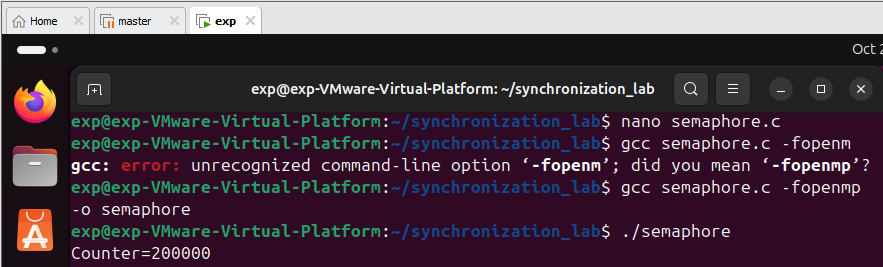
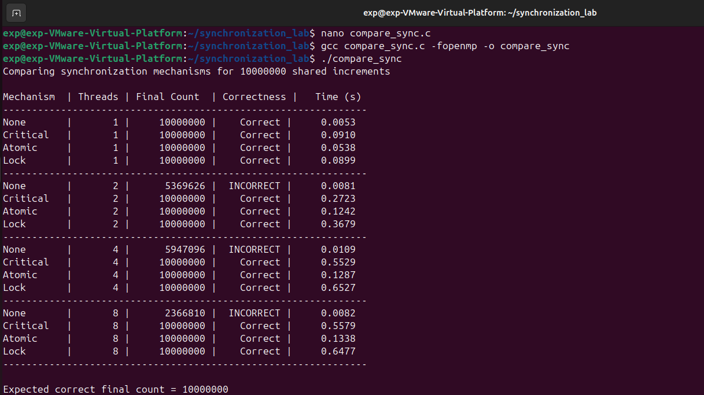

# Experiment 5 – Synchronization Mechanism

## Aim

To study and implement synchronization mechanisms in Operating Systems to manage concurrent processes and prevent race conditions.

## Introduction

Synchronization is a fundamental concept in modern operating systems. It ensures that multiple processes or threads can access shared resources safely without causing data inconsistency or unexpected behavior.

When concurrent processes or threads access shared data simultaneously without proper control, the final outcome depends on the order of execution, leading to a race condition. Synchronization mechanisms enforce order and mutual exclusion to guarantee data consistency and system stability.

## Objectives

To understand the fundamentals of process and thread synchronization.

To analyze critical section problems in multi-threaded environments.

To observe race conditions and their impact on shared variables.

To implement synchronization primitives (e.g., POSIX Mutexes and Semaphores) in C.

To learn how concurrent processes coordinate to share system resources safely.

## Key Concepts Overview

| Concept | Description |
| :--- | :--- |
| Process Synchronization | Coordination of execution between multiple threads or processes to ensure a desired order and prevent data corruption. |
| Critical Section | The region of code that accesses shared variables or resources that must not be accessed concurrently by more than one thread. |
| Race Condition | A flaw where the timing or ordering of concurrent execution affects the correctness of a calculation or state. |
| Mutual Exclusion | A property ensuring that only one process/thread enters the critical section at any given time. |
| Mutex (Mutual Exclusion) | A locking mechanism used to synchronize access to a resource, allowing only one thread to hold the lock at a time. |
| Semaphore | A signaling mechanism (integer variable) used to control access to common resources using `wait()` (`sem_wait`) and `signal()` (`sem_post`) operations. |
| POSIX Threads (pthreads) | A standard C library for creating and manipulating execution threads concurrently. |

## System Requirements & Technologies Used

| Technology | Specification / Tool |
| :--- | :--- |
| **Operating System** | Ubuntu Linux |
| **Virtualization** | VMware Workstation / Oracle VirtualBox |
| **Programming Language** | C (POSIX standard) |
| **Compiler** | GCC (GNU Compiler Collection) |
| **Libraries Used** | `<pthread.h>`, `<semaphore.h>` |
| **Version Control** | Git and GitHub |


## File Details & Purpose

| File / Directory | Description |
| :--- | :--- |
| `README.md` | Provides complete documentation, concept explanations, and instructions for running the lab. |
| `Makefile` | Simplifies compilation and cleanup commands using standard make targets. |
| `src/program.c` | Core C implementation demonstrating critical sections, mutex locks, and semaphores. |
| `src/race_condition.c` | Shows unsynchronized concurrent thread execution leading to data inconsistency. |
| `src/mutex_sync.c` | Demonstrates thread-safe critical section management using `pthread_mutex_t`. |
| `src/semaphore_sync.c` | Demonstrates resource access control and signaling using `sem_t`. |
| `bin/program` | Binary executable created by gcc using the `-pthread` flag. |
| `docs/execution_output.log` | Text log recording execution runs for both unsynchronized and synchronized execution. |

## Summary of Operations & Expected Results

| Scenario | Mechanism Applied | Shared Resource Outcome | Expected Behavior |
| :--- | :--- | :--- | :--- |
| **Unsynchronized Execution** | None | Data Inconsistency / Race Condition | Counter value is incorrect or unpredictable due to interleaved operations. |
| **Synchronized Execution** | Mutex (`pthread_mutex_lock`) | Thread-Safe Access | Counter value reaches exact expected total deterministically. |
| **Producer-Consumer / Boundary** | Semaphore (`sem_wait` / `sem_post`) | Controlled Buffer / Resource Limits | Threads wait gracefully when resources are empty/full. |


## Execution Output Screenshots

### 1. Race Condition & Critical Section


### 2. Atomic & Barrier Synchronization


### 3. Semaphore Synchronization


### 4. OpenMP Thread Scaling (4, 8, 8 Threads)


### 5. Synchronization Comparison


### 6. Additional Execution Output


## Conclusion

Through this experiment, we studied and implemented POSIX synchronization primitives in Linux C programming. The practical implementation demonstrates how race conditions occur during unsynchronized resource sharing and how mutex locks and semaphores provide mutual exclusion to maintain data consistency in concurrent systems.


## Repository Structure

```text
├── sreenshots/
│   ├── Screenshot 2026-10-27 102333.png
│   ├── atomic and barrier.png
│   ├── compare_sync.png
│   ├── omp num threadusing 4,8,8.png
│   ├── race and critical.png
│   └── semaphore.png
├── README.md
├── atomic
├── atomic.c
├── barrier
├── barrier.c
├── compare_syn
├── compare_sync
├── critical.c
├── race.c
└── semaphore.c
